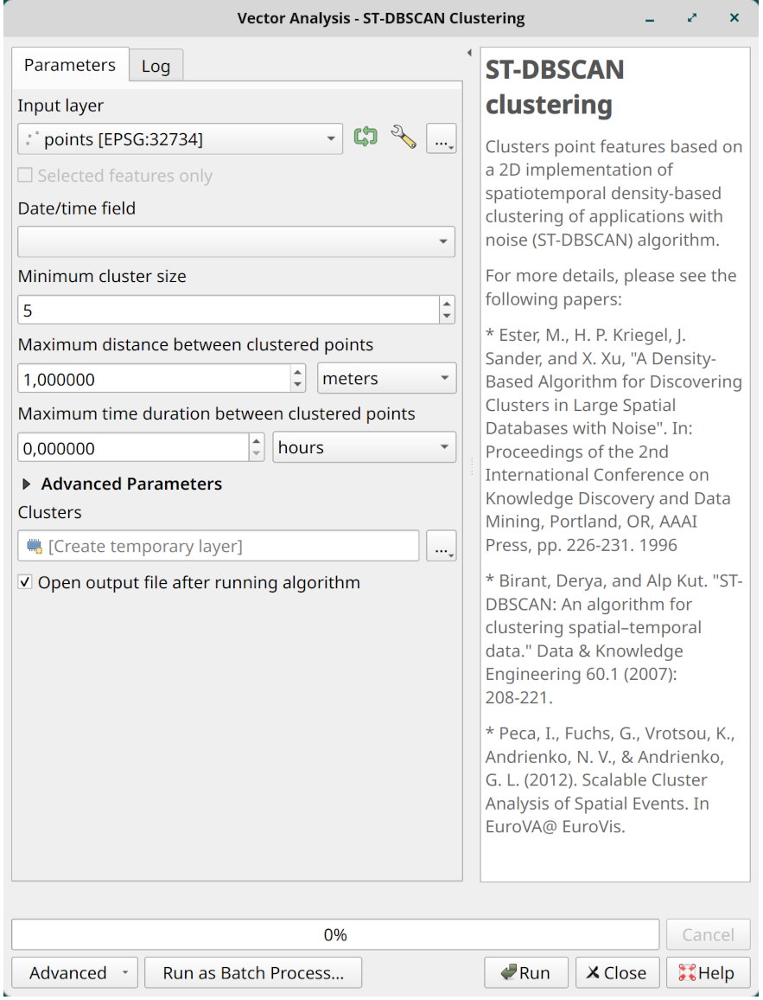

An important warning before starting
============================================================

Just like the manual of a word processor doesn't teach you how to write a novel
or a poem, or a CAD tutorial doesn't show you how to calculate the size of a
beam for a building, this guide will not teach you spatial analysis. Instead,
it will show you how to use the QGIS Processing framework, a powerful tool
for performing spatial analysis. It is up to you to learn the required
concepts that are needed to understand that type of analysis. Without them,
there is no point in using the framework and its algorithms, although you
might be tempted to try.

Let's show this more clearly with an example.

Given a point layer with a date/time field, you can find groups of points that
are close to each other in both space and time using the ST-DBSCAN clustering algorithm.
The parameters dialog for that algorithm looks like the following one.

It looks complex, right?

By reading this manual, you will learn things such as how to run it
in a batch process to create cluster layers from hundreds of point layers
in a single run, or what happens if the input layer has some points selected.
However, the parameters themselves are not explained.
A seasoned analyst with a good knowledge of spatiotemporal analysis will have
no problem choosing a suitable minimum cluster size, maximum distance
and maximum time duration. If you are not one of them and density-based clustering,
noise points or spatial and temporal neighborhoods are not familiar concepts to you,
then you should study and understand them before coming back.
The same points can form very different clusters just by changing one value,
and the algorithm will never tell you which value is right.
Ignoring this will result in misleading clusters and poor analysis.

Although not all algorithms are as complex as ST-DBSCAN clustering (but some of them are
even more complex!), almost all of them require understanding the fundamental
analysis ideas that they are based on. Without that knowledge, using them will
most likely lead to poor results.

Using algorithms without having a good foundation of spatial analysis is
like trying to write a novel without knowing anything about grammar or syntax,
and having no knowledge about storytelling. You might get a result, but it is
likely to have no value at all.  Please, don't fool yourself and think that
after reading this guide you are already capable of performing spatial analysis
and get sound results. You need to study spatial analysis as well.

Here is a good reference that you can read to learn more about spatial data analysis.

*Geospatial Analysis (3rd Edition)*: A Comprehensive Guide to Principles, Techniques and Software Tools
Michael John De Smith, Michael F. Goodchild, Paul A. Longley

It is available online `here <https://www.spatialanalysisonline.com/>`_
