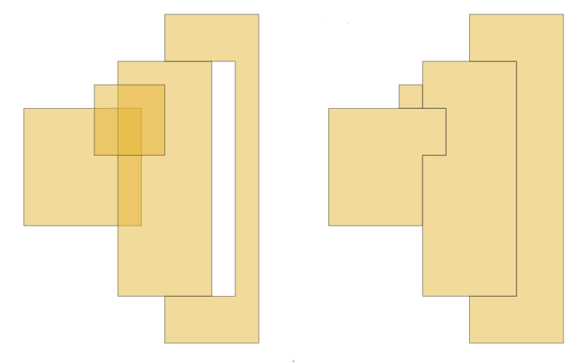

Vector coverage
===============

.. only:: html

   .. contents::
      :local:
      :depth: 1

.. _qgiscoverageclean:

Clean coverage
-----------------
``Added in 4.4``

Operates on a coverage (represented as a list of polygon features)
to fix cases where the geometry does not in fact exactly match,
repairing small overlaps and gaps to restore a valid topological coverage.

The algorithm uses a combination of snapping and gap/overlap merging.
Snapping to nearby vertices and line segments improves noding robustness and eliminates small errors.
If the snapping distance is not specified, an automatic distance based on the data extent is used.
A distance of 0 disables snapping.

Gaps and holes that are narrower than the a speified width are merged with an adjacent polygon.
Gaps which are not fully enclosed ("inlets") are not removed.
When repairing overlaps and gaps, a strategy can be used to determine which adjacent
polygon the problematic area is merged into (e.g., merging with the polygon that shares
the longest border, or the one with the maximum/minimum area).
Polygons that have collapsed during cleaning will be returned as empty polygons.

   Cleaning gaps and overlays within a coverage

|checkbox| Allows :ref:`features in-place modification <processing_inplace_edit>`
of polygon features

Parameters
..........

.. list-table::
   :header-rows: 1
   :widths: 20 20 20 40
   :class: longtable

   * - Label
     - Name
     - Type
     - Description
   * - **Input layer**
     - ``INPUT``
     - [vector: polygon]
     - Input polygon vector layer
   * - **Maximum gap width**
     - ``MAXIMUM_GAP_WIDTH``
     - [numeric: double]

       Default: 0.0
     - Gaps which are narrower than this distance are merged with an adjacent polygon.
       Polygon width is determined as twice the radius of the maximum inscribed circle of the gap polygon.
       Empty holes in input polygons are treated as gaps, and may be filled in.
       Gaps which are not fully enclosed ('inlets') are not removed.
   * - **Snapping distance**

       Optional
     - ``SNAPPING_DISTANCE``
     - [numeric: double]
     - Snapping to nearby vertices and line segment snapping is used to improve noding robustness
       and eliminate small errors in an efficient way. By default the snapping distance is not set,
       which means that the clean operation uses a very small snapping distance based on the extent of the input data.
       A distance of zero prevents snapping from being used.
   * - **Overlap merge strategy**
     - ``OVERLAP_MERGE_STRATEGY``
     - [enumeration]

       Default: 0
     - Determines the strategy used to merge gaps with adjacent polygons. One of:

       * 0 --- Longest border: the feature sharing the longest border with the gap
       * 1 --- Maximum area: the biggest adjacent feature
       * 2 --- Minimum area: the smallest adjacent feature
       * 3 --- Minimum index: the first encountered adjacent feature  (lowest ID)
   * - **Cleaned**
     - ``OUTPUT``
     - [vector: polygon]

       Default: ``[Create temporary layer]``
     - Specify the output vector layer with cleaned coverage.
       :ref:`One of <output_parameter_widget>`:

       .. include:: ../algs_include.rst
          :start-after: **layer_output_types**
          :end-before: **end_layer_output_types**

Outputs
.......

.. list-table::
   :header-rows: 1
   :widths: 20 20 20 40
   :class: longtable

   * - Label
     - Name
     - Type
     - Description
   * - **Cleaned**
     - ``OUTPUT``
     - [vector: polygon]
     - The output polygon vector layer with cleaned gaps and overlays.

Python code
...........

**Algorithm ID**: ``native:coverageclean``

.. include:: ../algs_include.rst
  :start-after: **algorithm_code_section**
  :end-before: **end_algorithm_code_section**

.. _qgiscoverageunion:

Dissolve coverage
-----------------
``Added in 3.36``

Operates on a coverage (represented as a set of polygon features with exactly matching edge geometry)
to dissolve (union) the geometries.
It provides a heavily optimized approach for unioning these features compared with the standard Dissolve tools.

.. seealso:: :ref:`qgisdissolve`

Parameters
..........

.. list-table::
   :header-rows: 1
   :widths: 20 20 20 40
   :class: longtable

   * - Label
     - Name
     - Type
     - Description
   * - **Input layer**
     - ``INPUT``
     - [vector: polygon]
     - Input polygon vector layer
   * - **Dissolved**
     - ``OUTPUT``
     - [vector: polygon]

       Default: ``[Create temporary layer]``
     - Specify the output vector layer. :ref:`One of <output_parameter_widget>`:

       .. include:: ../algs_include.rst
          :start-after: **layer_output_types**
          :end-before: **end_layer_output_types**

Outputs
.......

.. list-table::
   :header-rows: 1
   :widths: 20 20 20 40
   :class: longtable

   * - Label
     - Name
     - Type
     - Description
   * - **Dissolved**
     - ``OUTPUT``
     - [vector: polygon]
     - The output polygon vector layer with dissolved geometries.

Python code
...........

**Algorithm ID**: ``native:coverageunion``

.. include:: ../algs_include.rst
  :start-after: **algorithm_code_section**
  :end-before: **end_algorithm_code_section**

.. _qgiscoveragesimplify:

Simplify coverage
-----------------
``Added in 3.36``

Operates on a coverage (represented as a set of polygon features with exactly matching edge geometry)
to apply a Visvalingam–Whyatt simplification to the edges, reducing complexity in proportion with the provided tolerance,
while retaining a valid coverage (i.e. no edges will cross or touch after the simplification).
Geometries will never be removed, but they may be simplified down to just a triangle.
Also, some geometries (such as polygons which have too few non-repeated points) will be returned unchanged.

If the input dataset is not a valid coverage due to overlaps, it will still be simplified,
but invalid topology such as crossing edges will still be invalid.

|checkbox| Allows :ref:`features in-place modification <processing_inplace_edit>`
of polygon features

.. attention:: Running this algorithm requires QGIS installed with GEOS_ >= 3.12
   (see :menuselection:`Help --> About` menu).

.. seealso:: :ref:`qgissimplifygeometries`, :ref:`qgissmoothgeometry`

Parameters
..........

.. list-table::
   :header-rows: 1
   :widths: 20 20 20 40
   :class: longtable

   * - Label
     - Name
     - Type
     - Description
   * - **Input layer**
     - ``INPUT``
     - [vector: polygon]
     - Input polygon vector layer
   * - **Tolerance**
     - ``TOLERANCE``
     - [numeric: double]

       Default: 0.0
     - The maximum distance (in unit of choice) between two consecutive vertices to get merged.
   * - **Preserve boundary**
     - ``PRESERVE_BOUNDARY``
     - [boolean]

       Default: False
     - When enabled, the outside edges of the coverage will be preserved without simplification
   * - **Simplified**
     - ``OUTPUT``
     - [vector: polygon]

       Default: ``[Create temporary layer]``
     - Specify the output vector layer. :ref:`One of <output_parameter_widget>`:

       .. include:: ../algs_include.rst
          :start-after: **layer_output_types**
          :end-before: **end_layer_output_types**

Outputs
.......

.. list-table::
   :header-rows: 1
   :widths: 20 20 20 40
   :class: longtable

   * - Label
     - Name
     - Type
     - Description
   * - **Simplified**
     - ``OUTPUT``
     - [vector: polygon]
     - The output polygon vector layer, with a lower number of vertices.

Python code
...........

**Algorithm ID**: ``native:coveragesimplify``

.. include:: ../algs_include.rst
  :start-after: **algorithm_code_section**
  :end-before: **end_algorithm_code_section**

.. _qgiscoveragevalidate:

Validate coverage
-----------------
``Added in 3.36``

Analyzes a coverage (represented as a set of polygon features with exactly matching edge geometry)
to find places where the assumption of exactly matching edges is not met.
Invalidity includes polygons that overlap or that have gaps smaller than the specified gap width.

.. attention:: Running this algorithm requires QGIS installed with GEOS_ >= 3.12
   (see :menuselection:`Help --> About` menu).

.. seealso:: :ref:`qgischeckvalidity`, :ref:`qgischeckgeometrygap`,
   :ref:`qgischeckgeometryoverlap`

Parameters
..........

.. list-table::
   :header-rows: 1
   :widths: 20 20 20 40
   :class: longtable

   * - Label
     - Name
     - Type
     - Description
   * - **Input layer**
     - ``INPUT``
     - [vector: polygon]
     - Input polygon vector layer
   * - **Gap width**
     - ``GAP_WIDTH``
     - [numeric: double]

       Default: 0.0
     - The maximum width of gap to detect
   * - **Invalid edges**
     - ``INVALID_EDGES``
     - [vector: line]

       Default: ``[Create temporary layer]``
     - Specify the output vector layer. :ref:`One of <output_parameter_widget>`:

       .. include:: ../algs_include.rst
          :start-after: **layer_output_types_skip**
          :end-before: **end_layer_output_types_skip**

Outputs
.......

.. list-table::
   :header-rows: 1
   :widths: 20 20 20 40
   :class: longtable

   * - Label
     - Name
     - Type
     - Description
   * - **Invalid edges**
     - ``OUTPUT``
     - [vector: line]
     - The output line vector layer showing error edges for each invalid polygon.
   * - **Validity result**
     - ``IS_VALID``
     - [boolean]
     - Returns whether the coverage is valid or not.

Python code
...........

**Algorithm ID**: ``native:coveragevalidate``

.. include:: ../algs_include.rst
  :start-after: **algorithm_code_section**
  :end-before: **end_algorithm_code_section**

.. _GEOS: https://libgeos.org/

.. Substitutions definitions - AVOID EDITING PAST THIS LINE
   This will be automatically updated by the find_set_subst.py script.
   If you need to create a new substitution manually,
   please add it also to the substitutions.txt file in the
   source folder.

.. |checkbox| image:: /static/common/checkbox.png
   :width: 1.3em
